

> Articket은 관객이 공연을 둘러보고 **좌석 선점 현황을 실시간**으로 확인한 뒤, <b>좌석 임시 확보(선점)</b>와 결제를 거쳐 예매를 확정할 수 있도록 설계된 공연 예매 플랫폼입니다.
> 관리자 드래그앤드롭 에디터로 좌석맵을 생성하여, 개발자의 하드코딩 없이 사용자와 동일한 경험을 제공합니다.

---

## 팀 소개

| 김정훈                                                       | 김진경                                                       | 이지연                                                       |
| ------------------------------------------------------------ | ------------------------------------------------------------ | ------------------------------------------------------------ |
|  |  |  |
| <a href="https://github.com/jeonghuny">🔗 [jeonghuny]</a>    | <a href="https://github.com/realview45">🔗 [realview45]</a>  | <a href="https://github.com/jiyean99">🔗 [jiyean99]</a>      |

 

## 프로젝트 미리보기

## 목차

- [🎯 1. 프로젝트 기획 (배경 및 방향)](#1-프로젝트-기획-배경-및-기대효과)
- [💡 2. 주요 기능과 기술 및 트러블 슈팅](#2-주요-기능과-기술-및-트러블-슈팅)
- [🔎 3. 프로젝트 설계 및 주요 산출물](#3-프로젝트-설계-및-주요-산출물)
- [🧰 4. 기술 스택](#4-기술-스택)
- [🎥 5. 프로젝트 시연](#5-프로젝트-시연)
- [📝 6. 회고](#7-회고)

 

## 1. 프로젝트 기획 (배경 및 기대효과)

📚 기획 배경

 
인기 공연·이벤트 예매는 오픈 직후 짧은 시간에 트래픽이 집중되며,  좌석 선택과 결제 과정에서 사용자가 큰 혼선을 겪기 쉽습니다.

특히 좌석 상태가 빠르게 변하는 상황에서는  **"지금 보이는 좌석이 실제로 예매 가능한 좌석인지"** 확신하기 어렵고,  
결제 지연 또는 실패가 발생하면 **확보한 좌석을 놓칠 수 있다는 불안**이 커집니다.

또한 기존의 새로고침 기반 갱신 방식은 다음과 같은 한계를 가졌습니다.

- 실시간 반영이 늦어 현재 좌석 상태를 신뢰하기 어렵다.
- 반복 요청이 늘어나 서버 부하가 커진다.
- 사용자는 좌석 선택과 결제 과정에서 더 큰 긴장감을 느끼게 된다.

기존 플랫폼의 운영 방식 역시 비효율적이었습니다.
기존 방식은
이미지 좌석맵 업로드 → 개발자가 영역별 좌표를 하드코딩  
새로운 공연장이나 좌석 구조가 추가될 때마다  
**수일 단위 배포 지연**과 **프론트/백엔드 재개발**이 반복되었습니다.

이러한 문제를 해결하기 위해 Articket은  
사용자에게는 **신뢰할 수 있는 실시간 예매 경험**을,  
운영자에게는 **유연하게 관리 가능한 좌석 운영 환경**을 제공하는 방향으로 기획했습니다.

 

🎯 기획 목표

- 사용자가 실시간으로 변하는 좌석 상태를 신뢰할 수 있는 예매 경험 제공
- 결제 전 좌석 임시 확보를 통해 동시 접속 환경에서의 혼선 최소화
- 좌석 선택부터 결제, 예매 확정까지 끊김 없는 일관된 사용자 흐름 구현
- 새로고침 중심의 비효율적인 갱신 방식 대신 실시간 반영 구조 도입
- 운영자가 직접 좌석맵을 구성하고 관리할 수 있는 유연한 운영 환경 마련
   

💡 기대 효과

- **사용자 관점**: 좌석 선택 과정에서의 불안과 혼선을 줄이고, 현재 상태를 신뢰할 수 있는 예매 경험 제공
- **시스템 관점**: 동시성 이슈를 고려한 임시 확보 및 확정 처리 구조 설계
- **운영 관점**: 개발자 의존도를 낮추고, 공연장/좌석 구조 변경에 빠르게 대응할 수 있는 관리 환경 구축
   

---

## 2. 주요 기능과 기술 및 트러블 슈팅

핵심 기능은 사용자가 실제 예매 과정에서 자주 접하는 흐름을 기준으로 구성했습니다.  
기능 구현 과정에서는 UI/UX뿐 아니라 데이터 처리 방식, 상태 관리, 예외 상황 대응도 함께 고려했습니다.

💡 사용자별 기능

### 비인증 사용자(GUEST)

> 로그인 없이 "둘러보기"만 가능한 사용자
> 결제/선점/내정보는 불가 (입구에서 컷)

- 탐색(공연 조회)
- 인증(회원가입/로그인)

### 인증 사용자(USER)

> 좌석을 "선점 → 결제 → 확정"하는 실제 구매자
> 선점은 Redis TTL, 결제는 Portone 게이트웨이 연동 기반

- 내 정보
- **좌석 선점(핵심)**
- 주문/결제(예약 확정)
- **WebSocket 실시간 좌석(구독)**

### ORGANIZER 역할

> 공연을 **"기획하고 판매하는 사람"**
> 플랫폼 자산(공연장, 좌석배치도)은 **읽기 전용** (관리자쪽)

- 대시보드
- 공연 생성 & 수정
- **공연장 & 좌석배치도 조회**
- 회차 관리
- 좌석 가격 관리
- 정책 관리(선예매/할인)
- 주문 조회

### ADMIN 역할(플랫폼 운영자)

> **플랫폼 자산 + 보안/차단** 등 **"시스템 운영"** 담당
- **플랫폼 자산 관리(공연장/좌석맵)**
- **동적 좌석맵 에디터** (드래그앤드롭 → 실시간 생성)

🎯 주요 기능

### 1. 실시간 좌석 조회 및 선점

- 사용자는 예매 화면에서 현재 좌석 상태를 실시간으로 확인할 수 있습니다.
- 좌석 선택 후 즉시 임시 확보가 이루어지며, 다른 사용자 화면에도 상태가 반영됩니다.
- 선점 좌석은 일정 시간이 지나면 자동 해제되어, 결제가 완료되지 않은 좌석이 장시간 점유되지 않도록 구성했습니다.

### 2. 좌석 선점 기반 결제 확정

- 결제 단계에서는 사용자가 실제로 선점한 좌석인지 다시 검증한 뒤 주문이 생성됩니다.
- 이를 통해 선점되지 않은 좌석으로 결제가 진행되는 문제를 방지하고, 예매 확정의 안정성을 높였습니다.
- 예매 흐름을 `좌석 선택 → 선점 → 결제 → 확정`으로 일관되게 설계했습니다.

### 3. 소셜 로그인 기반 인증

- 사용자는 일반 회원가입 외에도 Google, Kakao 기반 간편 로그인을 사용할 수 있습니다.
- 소셜 인증 이후 서비스 전용 토큰을 발급하여, 사용자 인증 흐름과 내부 권한 체계를 통합했습니다.
- 인증 이후에는 일반 회원과 동일하게 예매 기능을 사용할 수 있도록 구성했습니다.

### 4. 실시간 알림

- 결제 완료, 공연 관련 상태 변경, 관리자 승인 등 주요 이벤트를 실시간으로 전달합니다.
- 사용자는 새로고침 없이 알림 패널과 토스트 UI를 통해 즉시 상태 변화를 확인할 수 있습니다.
- 단방향 이벤트 전달에 적합한 구조를 적용해 알림 기능의 효율성과 확장성을 확보했습니다.

### 5. 위치 기반 공연장 탐색

- 사용자는 현재 위치를 기준으로 가까운 공연장을 탐색할 수 있습니다.
- 지도 기반 UI와 거리 계산 로직을 결합하여, 주변 공연장 탐색 경험을 직관적으로 제공했습니다.
- 운영 측면에서는 공연장 위치 정보를 보다 구조적으로 관리할 수 있도록 설계했습니다.

### 6. 동적 좌석맵 에디터

- 관리자는 드래그앤드롭 방식으로 좌석 구역과 좌석 배치를 직접 구성할 수 있습니다.
- 기존처럼 이미지 업로드 후 개발자가 좌표를 하드코딩하지 않아도, 공연장 좌석 구조를 빠르게 반영할 수 있습니다.
- 이를 통해 사용자 화면과 관리자 설정 화면 간 일관성을 유지하고, 운영 효율을 크게 높였습니다.

💡 핵심 기술

| 사용 기술                               | 설명                                                                                                           |
| --------------------------------------- | -------------------------------------------------------------------------------------------------------------- |
| **Redis TTL 임시 좌석 선점**            | 좌석 선택 시 Redis에 TTL(5분/300초)로 임시 확보, Lua 스크립트 원자 실행으로 동시성 충돌 완전 방지 및 자동 해제 |
| **Portone 결제 게이트웨이**             | 선점 검증 → 주문 생성 → Portone API 결제 확인 → 티켓 발급의 안전한 단계별 확정 흐름                         |
| **WebSocket + STOMP**                   | 좌석 상태 실시간 푸시 (새로고침 불필요),`/topic/seat` 단일 채널 브로드캐스트             |
| **Spring Security + JWT**               | Access(60분) / Refresh(50시간) Token 이중 보안, Redis 저장으로 로그아웃·강제 만료 즉시 처리                   |
| **회원 우선 탐색**                   	  | 로그인하여 공연/좌석 미리보기 → UX 개선 + 전환율 ↑                                                     |
| **Soft Delete 패턴**                    | 회원/주문 데이터 논리 삭제 (`delYn`), 관리자 복구 및 감사 로그 지원, 재가입 허용을 위한 이메일 nullify         |
| **SSE + Redis Pub/Sub 실시간 알림**     | 결제·공연·관리자 이벤트 실시간 푸시, Redis Pub/Sub으로 다중 서버 환경 브릿지, 폴링 제거                      |
| **Kakao Map API + Haversine 공간 쿼리** | 공연장 주소 위경도 저장, JPQL Haversine 공식으로 반경 내 공연장 검색 (`/venues/nearby`)                        |
| **동적 좌석맵 에디터**                  | 관리자 드래그앤드롭으로 섹션·좌석 배치,`SeatDefinition` 좌표 저장, 개발자 하드코딩 불필요                     |

> **핵심 차별점**: **Redis Lua 원자 선점 → Portone 결제 확정** 흐름으로 좌석 경쟁을 안전하게 해결.
> 실시간 WebSocket으로 "지금 보이는 게 실제" 신뢰 확보!

🛠 트러블 슈팅

### 1. 좌석 선점 과정에서의 동시성 충돌

- 문제 상황: 여러 사용자가 같은 좌석을 거의 동시에 선택할 때, 중복 선점이 발생할 가능성이 있었습니다.
- 원인: 단순 조회 후 저장하는 방식은 요청 사이의 짧은 간격에서 경쟁 상태가 발생할 수 있었습니다.
- 해결 방법: 좌석 선점 검증과 저장을 원자적으로 처리하는 방식으로 전환해 중복 선점을 방지했습니다.
- 배운 점: 티켓팅처럼 경쟁이 심한 환경에서는 단순 CRUD보다 동시성 제어 전략이 핵심이라는 점을 확인했습니다.

### 2. 선점 만료 이벤트가 정상적으로 동작하지 않는 문제

- 문제 상황: 선점 시간이 끝나도 좌석이 자동으로 해제되지 않는 문제가 있었습니다.
- 원인: Redis의 만료 이벤트 수신 기능이 기본 설정에서는 활성화되어 있지 않았습니다.
- 해결 방법: 애플리케이션 시작 시 만료 이벤트 설정을 자동 적용하고, 만료 감지 후 좌석 상태를 정리하도록 구성했습니다.
- 배운 점: 외부 인프라 기능은 코드 구현뿐 아니라 런타임 설정까지 함께 검증해야 한다는 점을 배웠습니다.

### 3. 선점 만료 시 좌석 상태 불일치 가능성

- 문제 상황: 만료 시점이 거의 같은 여러 키가 완전히 동시에 정리되지 않아, 짧은 순간 좌석 상태 불일치 가능성이 있었습니다.
- 원인: Redis 만료 처리는 키 단위로 독립적으로 일어나기 때문에 미세한 시간 차가 발생할 수 있었습니다.
- 해결 방법: 만료 이벤트 처리 시 관련 키를 명시적으로 함께 정리해 상태 일관성을 높였습니다.
- 배운 점: 실시간 시스템에서는 “거의 동시에”도 예외 상황으로 보고 방어적으로 설계해야 함을 확인했습니다.

### 4. Redis 이벤트 간 간섭 문제

- 문제 상황: 좌석 선점 만료 이벤트와 다른 실시간 기능용 Redis 이벤트가 서로 영향을 줄 수 있었습니다.
- 원인: 하나의 Redis 데이터베이스에서 여러 목적의 키와 이벤트를 함께 관리했기 때문입니다.
- 해결 방법: 좌석 선점용 Redis와 알림용 Redis 영역을 분리해 이벤트 오염을 방지했습니다.
- 배운 점: 실시간 기능이 많아질수록 저장소를 논리적으로 분리하는 설계가 운영 안정성에 중요하다는 점을 배웠습니다.

### 5. 소셜 로그인 공급자별 식별자 타입 차이

- 문제 상황: 소셜 로그인 제공자마다 사용자 식별자 형식이 달라 통합 처리에 어려움이 있었습니다.
- 원인: 어떤 서비스는 문자열, 어떤 서비스는 숫자형 식별자를 제공했습니다.
- 해결 방법: 내부적으로 하나의 유연한 타입으로 통합해 저장하고 처리하도록 구조를 맞췄습니다.
- 배운 점: 외부 플랫폼 연동은 표면적으로 비슷해 보여도 데이터 형식 차이를 반드시 고려해야 한다는 점을 확인했습니다.

### 6. SSE 인증 연결 문제

- 문제 상황: 실시간 알림 연결 시 기본 브라우저 API만으로는 인증 헤더를 전달하기 어려웠습니다.
- 원인: 표준 EventSource는 Authorization 헤더 설정에 제약이 있었습니다.
- 해결 방법: 인증 헤더를 지원하는 방식으로 연결 구조를 보완해 JWT 기반 SSE 연결을 구현했습니다.
- 배운 점: 기술 선택 시 “지원 여부”뿐 아니라 실제 인증/운영 조건까지 함께 검토해야 한다는 점을 배웠습니다.

### 7. 지도 기반 공연장 탐색에서의 렌더링 이슈

- 문제 상황: 지도 화면이 탭 전환이나 모달 진입 시 정상적으로 표시되지 않는 경우가 있었습니다.
- 원인: 지도 API 렌더링 시점과 프론트엔드 컴포넌트 생명주기가 맞지 않았습니다.
- 해결 방법: 화면 표시 시점에 맞춰 지도 레이아웃과 중심 좌표를 다시 계산하도록 처리했습니다.
- 배운 점: 외부 UI SDK는 단순 삽입이 아니라 화면 생명주기와 함께 제어해야 안정적으로 동작한다는 점을 체감했습니다.

## 3. 프로젝트 설계 및 주요 산출물

### 요구사항 명세서

<a href="https://docs.google.com/spreadsheets/d/1wvPbU3cpkc5v6pNopNGYWIIp6Pc-fyFyQHueswUGb9c/edit?gid=782621183#gid=782621183">🔗 [요구사항 명세서 URL]</a>

---
### WBS

<a href="https://docs.google.com/spreadsheets/d/1wvPbU3cpkc5v6pNopNGYWIIp6Pc-fyFyQHueswUGb9c/edit?gid=1947580387#gid=1947580387">🔗 [WBS URL]</a>

---

### Entity Relationship Diagram (ERD)

<a href="https://www.erdcloud.com/d/XmcHxhqn5Zoc4fuhG">🔗 [ERD URL]</a>

다이어그램 펼쳐보기

 
	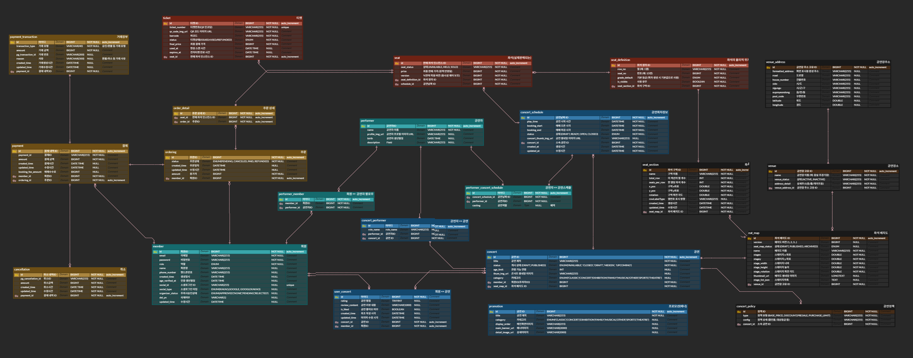

---

### API 설계 문서

<a href="https://documenter.getpostman.com/view/52251055/2sBXcHgy9C">🔗 [POSTMAN URL]</a>

---

### 인프라 구성도 & 배포 아키텍처 및 CI/CD 파이프라인

다이어그램 펼쳐보기

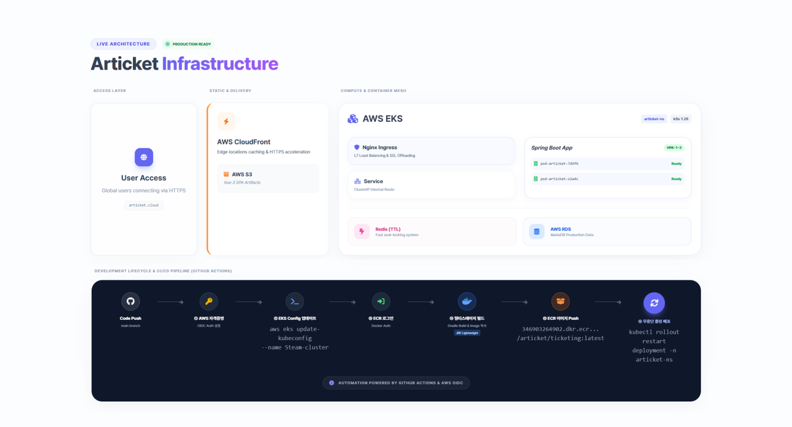

--- 

### 테스트 계획 및 결과 보고서

<a href="https://docs.google.com/spreadsheets/d/1wvPbU3cpkc5v6pNopNGYWIIp6Pc-fyFyQHueswUGb9c/edit?gid=888589992#gid=888589992">🔗 [QA 테스트 케이스 URL]</a>

---

## 4. 기술 스택

기술 스택 보기

### Frontend

### Backend

### Database / Infra

### Authentication / External API

### Real-time

### Collaboration / Design

## 5. 프로젝트 시연

프로젝트 시연 보기

 

[GUEST] USER 회원가입 - 일반

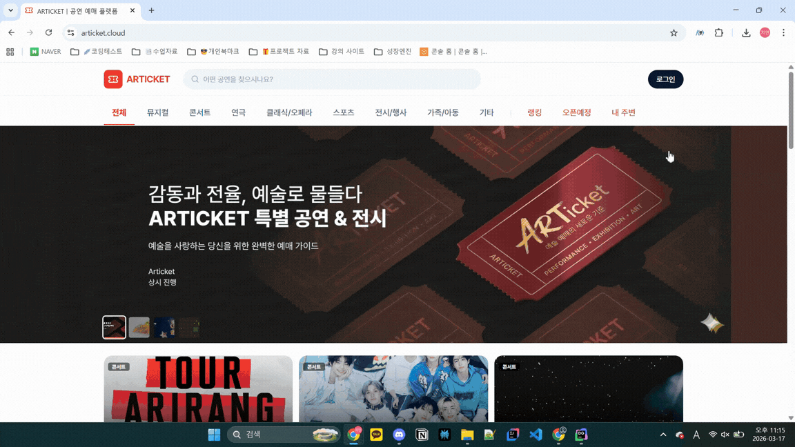

- 실시간 유효성 검사 (정규식)
- 비밀번호 보안 강도 표시
- OAuth 2.0 인증 플로우

[GUEST] USER 회원가입 - SNS

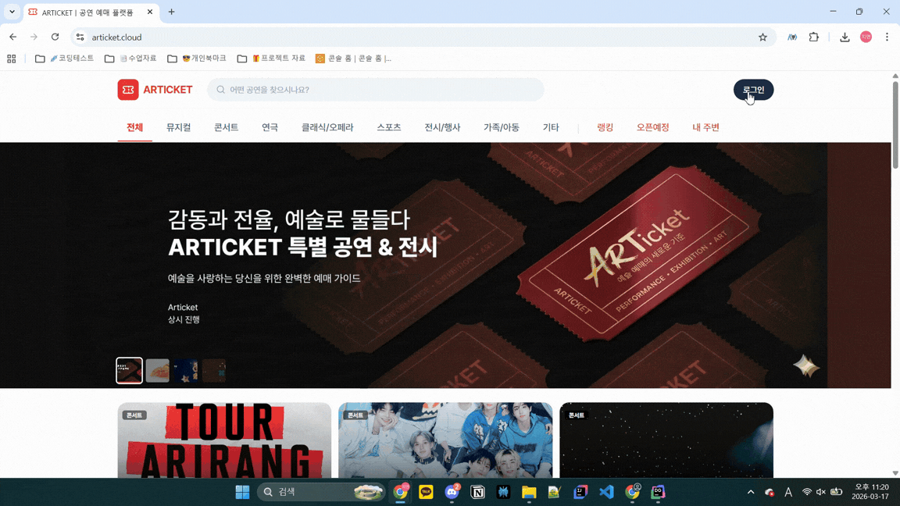

- 카카오/네이버/구글 소셜 로그인

[GUEST] ORGANIZER 회원가입

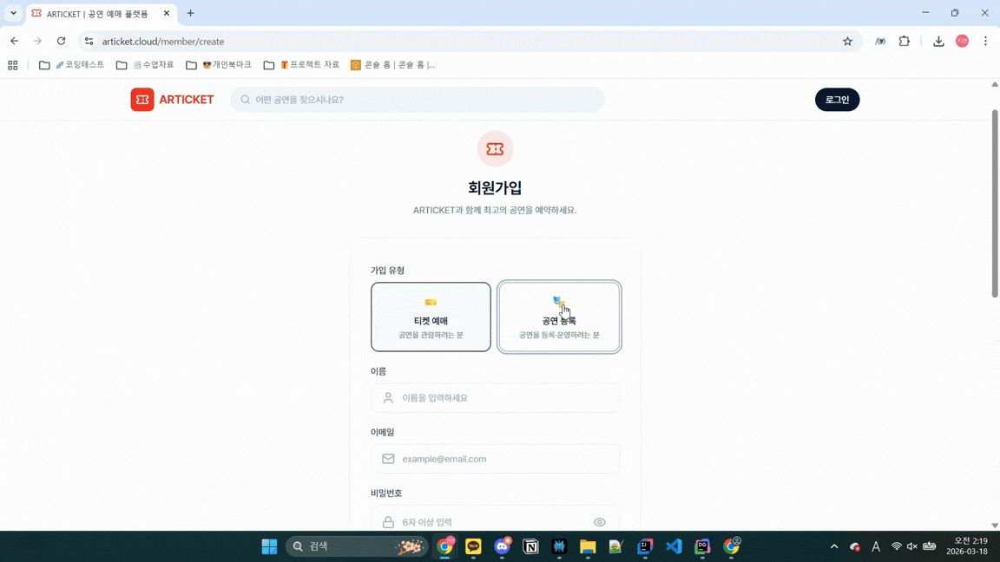

- 관리자 권한 부여 프로세스

[GUEST] 공연/아티스트/공연장 통합 검색

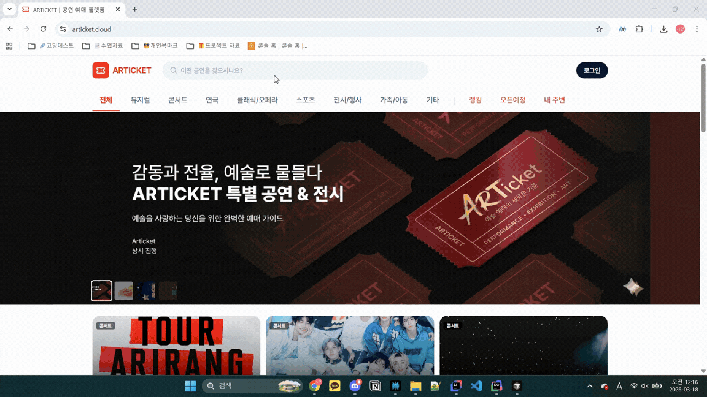

- 공연 장르(카테고리), 판매 상태, 지역, 날짜 범위(시작/종료일) 필터 지원

[ADMIN] 관리자페이지 - 대시보드

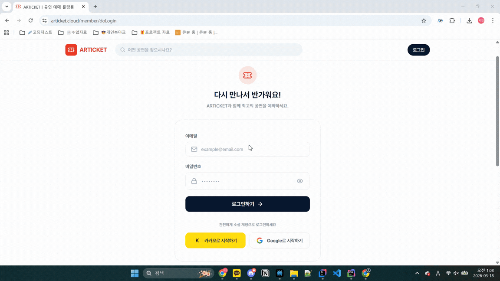

- 전체 가입자/신규회원/활성공연 및 공연장/프로모션 배너 수 등 핵심 KPI 카드 제공
- 회원가입 추이 차트(전체/USER/ORGANIZER)로 기간별 가입 흐림
- 승인 대기 주최자 미리보기 리스트 및 빠른 승인/거절 액션
- 주요 화면으로 이동하는 퀵카드

[ADMIN] 관리자페이지 - 공연장 인사이트

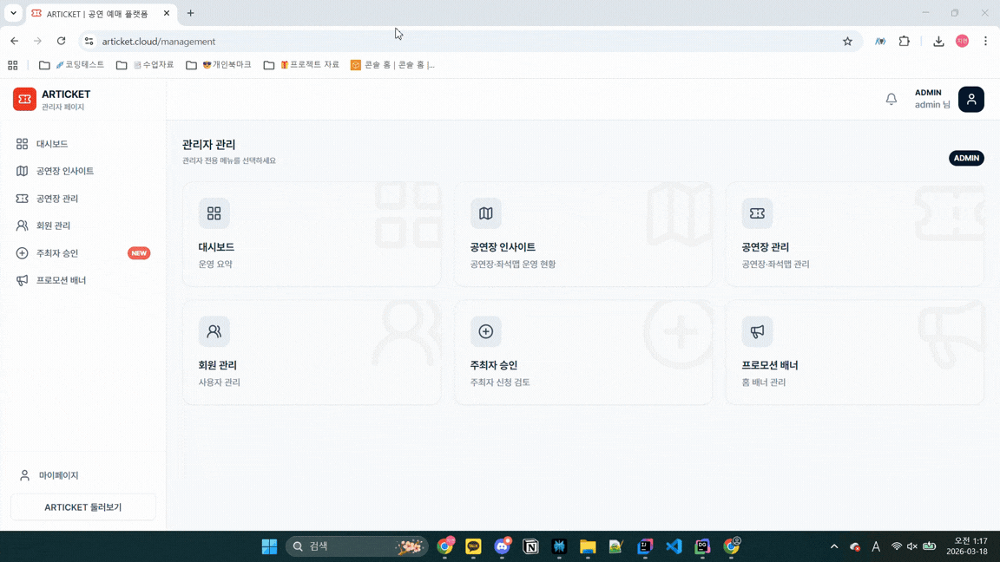

- 공연장별 점유율, 매출, 공연수 등 통계카드/차트 제공
- 필터(기간, 공연장)로 인사이트 탐색

[ADMIN] 관리자페이지 - 회원관리

- 전체 회원 목록(검색, 역할 필터, 정렬) 관리
- 각 회원별 상세/주문/공연 조회로 진입할 수 있는 허브

[ADMIN] 관리자페이지 - 주최자 승인

- 주최자 신청자 목록과 신청 정보(이메일, 이름, 신청일 등) 표시
- 한 화면에서 승인/거절 액션 및 상태 업데이트

[ADMIN] 관리자페이지 - 프로모션 배너

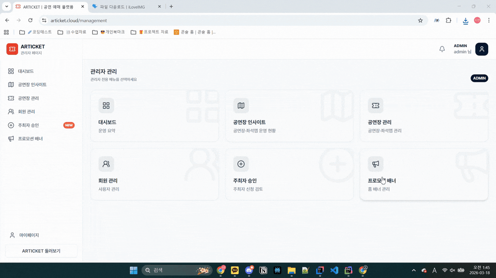

- 홈 히어로/프로모션용 배너 목록 관리(제목, 기간, 노출 여부)
- 생성/수정/삭제 및 정렬, 검색 기능

[ORGANIZER] 관리자페이지 - 대시보드

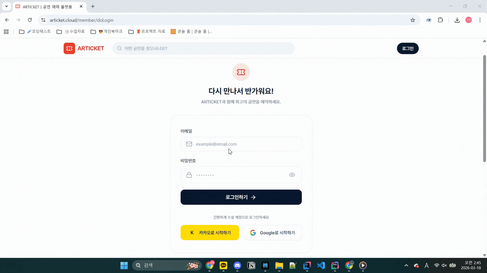

- 내 공연/매출/좌석 점유율 등 핵심 지표 카드로 요약
- 주요 공연들의 최근 판매 흐름, 좌석 인사이트 링크 제공
- 공연 관리/보고서/좌석 인사이트 등 주요 기능 허브

[ORGANIZER] 관리자페이지 - 정산/리포트

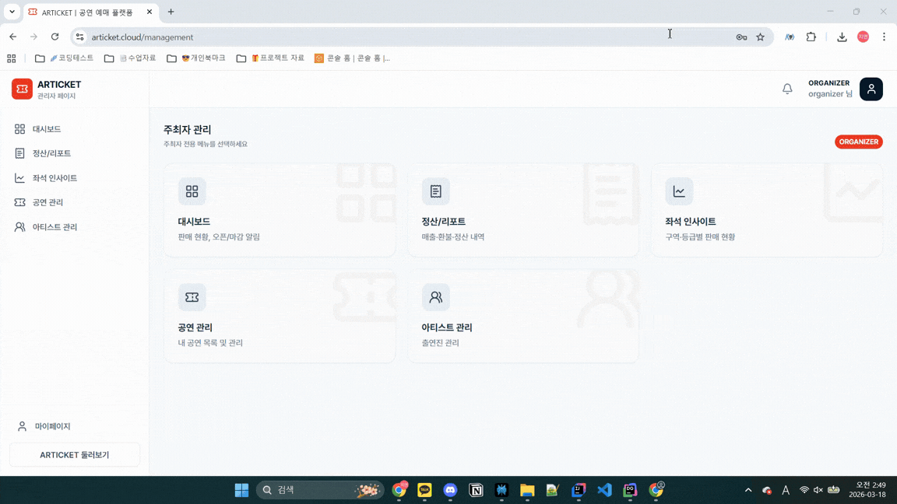

- 일정 기간 동안의 공연/회차별 매출, 정산, 취소·환불 등 요약 카드 및 리스트
- 세부 보고서 뷰에서 공연·회차·주문 단위까지 Drill-down

[ORGANIZER] 관리자페이지 - 좌석 인사이트

- 공연/회차별 좌석 판매 현황, 구역별 예매 패턴 등 시각화
- 특정 주문 기반 좌석 하이라이트 등 운영 인사이트 제공

[ORGANIZER] 관리자페이지 - 공연관리 공연생성

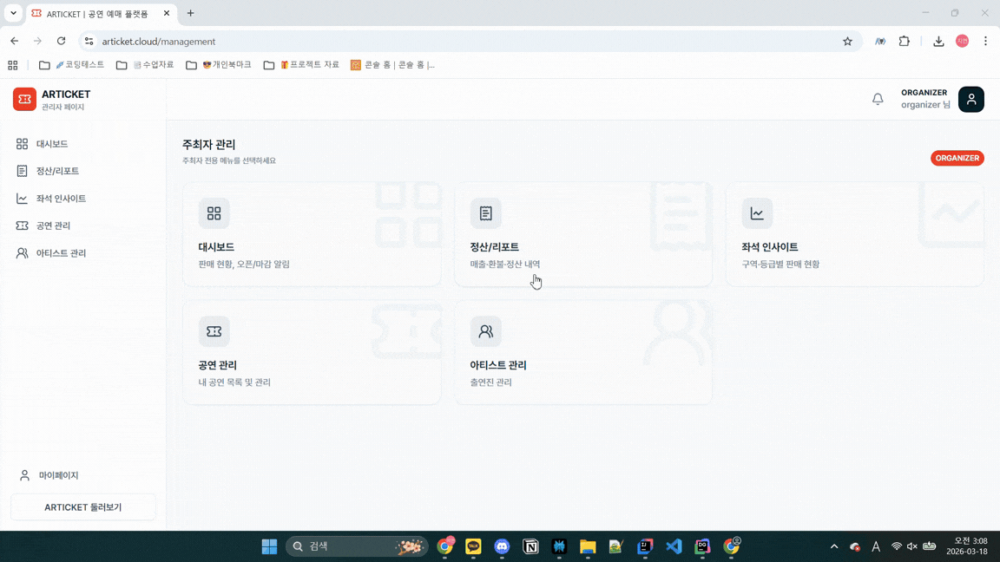

- 공연 기본정보 입력(제목, 카테고리, 기간, 장소, 썸네일 등)
- 다단계 폼 구성 – 공연 생성 후 정책 설정 단계로 이어짐

[ORGANIZER] 관리자페이지 - 공연관리 공연상세

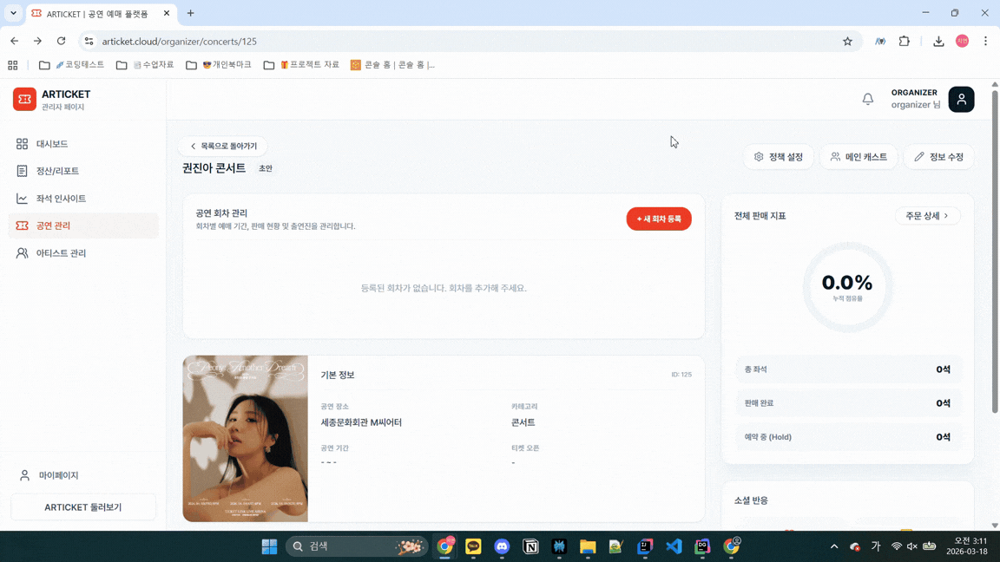

- 상단: 공연 기본 정보 + 상태 배지 + 주요 액션(정책 설정, 메인 캐스트, 정보 수정, 게시 등)
- 좌측: 회차 관리(스케줄 리스트, 예매 기간, 점유율, 수정/일괄생성 모달)
- 우측: 공연 전체 판매 지표(점유율, 판매 좌석 수 등 원형 차트), 소셜 반응(좋아요, 리뷰 수), 좌석맵 미리보기

[ORGANIZER] 관리자페이지 - 공연관리 공연상세 회차생성

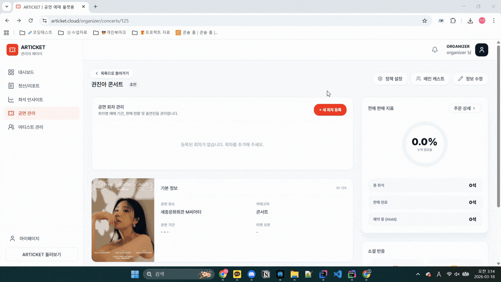

- 예매 오픈일에 따라 게시 상태 UI 동적 변경

## 6. 회고

회고 보기

