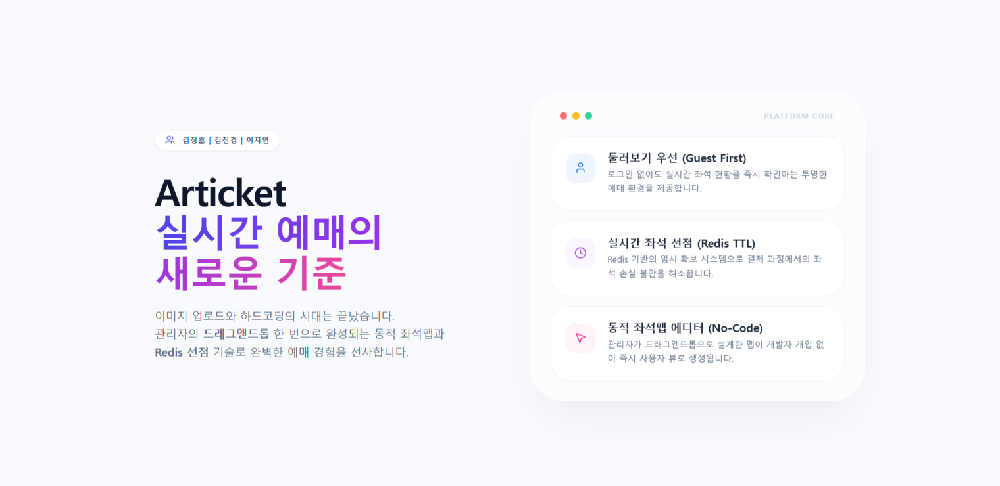

	

> ‘SeatFlow(가명)’는 “좌석의 흐름을 끊김 없이 이어가다(Seat + Flow)”라는 의미를 담고 있습니다.
관객이 공연을 둘러보고 **좌석 현황을 실시간**으로 확인한 뒤, <b>좌석 임시 확보(선점)</b>와 결제를 거쳐 예매를 확정할 수 있도록 설계된 공연 예매 플랫폼입니다. 

***

## 팀 소개

| 김정훈 | 김진경 | 이지연 |
| --- | --- | --- |
|  |  |  |
| <a href="https://github.com/jeonghuny">🔗 [jeonghuny]</a> | <a href="https://github.com/realview45">🔗 [realview45]</a> | <a href="https://github.com/jiyean99">🔗 [jiyean99]</a> |

***

## 프로젝트 개요

### 🔹 배경
인기 공연/이벤트 예매는 오픈 직후 짧은 시간에 트래픽이 집중되며, 좌석 선택과 결제 과정에서 사용자가 혼선을 겪는 경우가 많습니다. 특히 좌석 상태가 빠르게 변하는 상황에서 “지금 보이는 좌석이 실제로 가능한지”를 확신하기 어렵고, 결제 지연/실패가 발생하면 확보한 좌석을 잃을 수 있다는 불안이 커집니다.

또한 새로고침 기반 갱신은 실시간성이 떨어질 뿐 아니라 불필요한 요청을 늘려 서버 부하를 키울 수 있습니다. 비회원에게 탐색 정보를 제한하는 방식은 로그인 강요로 이어져, 사용자가 충분히 비교·검토하기 전에 이탈하는 UX가 발생하기도 합니다.

### 🔹 솔루션 개요
SeatFlow는 위 문제를 해결하기 위해 “실시간 좌석 반영 → 좌석 임시 확보(선점) → 주문/결제 → 확정”을 하나의 일관된 흐름으로 연결한 공연 예매 플랫폼입니다.

- 👀 **둘러보기 우선**: 비회원도 공연/회차/좌석 정보를 충분히 확인한 뒤 예매 단계에서 인증을 진행합니다.  
- 💺 **임시 확보(선점)**: 좌석 선택 경쟁을 Redis TTL 기반의 임시 확보로 먼저 정리해 동시성 혼선을 줄입니다.  
- 🧾 **안정적인 확정 처리**: 결제 요청을 큐에 적재하고 워커가 순차적으로 확정 처리해 결과 일관성을 확보합니다.  
- 🔔 **실시간 반영**: WebSocket 구독으로 좌석 상태 변화를 즉시 전달해, 새로고침 없이 “현재 상태”를 신뢰할 수 있게 합니다.

***

## 주요 기능
<a href="https://ticket-service-fe.vercel.app/">🔗 [서비스 체험(Interactive Prototype)]</a> - 서비스 배포 시 제거될 예정입니다. 
<a href="https://www.figma.com/design/zUP4s1rnn62eMA5T0WlaEG/be23-2nd-team5?node-id=0-1&p=f">🔗 [디자인 프로토타입(Figma)]</a>

### 비인증 사용자(GUEST)
> 로그인 없이 “둘러보기”만 가능한 사용자
> 결제/선점/내정보는 불가 (입구에서 컷)
- 탐색(공연/회차/좌석 조회)
- 인증(회원가입/로그인)

### 인증 사용자(USER)
> 좌석을 “선점 → 결제 → 확정”하는 실제 구매자
> 선점은 Redis TTL, 확정은 Kafka 워커 처리 기반
- 내 정보
- 좌석 선점(핵심)
- 주문/결제(예약 확정)
- WebSocket 실시간 좌석(구독)

### ORGANIZER 역할
> 공연을 “기획하고 판매하는 사람”
> 단, 플랫폼 자산(공연장, 좌석맵)은 수정 불가 (관리자쪽)
- 대시보드
- 공연 생성 & 수정
- 공연장 & 좌석맵 조회(읽기 전용)
- 회차 관리
- 좌석 가격 관리
- 정책 관리(선예매/할인)
- 주문 조회(개인정보 마스킹)
- 로그 & 감사 조회(옵션)

### ADMIN 역할(플랫폼 운영자)
> 플랫폼 자산(공연장/좌석맵), 보안/차단/레이트리밋, 감사 로그 등 “시스템 운영” 담당
- 플랫폼 자산 관리(공연장/좌석맵)
- 보안/차단/운영

***

## 프로젝트 설계

***

## 요구사항 명세서
<a href="https://docs.google.com/spreadsheets/d/1wvPbU3cpkc5v6pNopNGYWIIp6Pc-fyFyQHueswUGb9c/edit?gid=782621183#gid=782621183">🔗 [요구사항 명세서 URL]</a>

## WBS
<a href="https://docs.google.com/spreadsheets/d/1wvPbU3cpkc5v6pNopNGYWIIp6Pc-fyFyQHueswUGb9c/edit?gid=1947580387#gid=1947580387">🔗 [WBS URL]</a>

## Entity Relationship Diagram (ERD)

 
	

	

***

## 서비스 별 주요 기능 소개

***

## 계층 구조 설계

***

## 클래스 간 관계도

***

## QA

***

## 시연영상

***

## 개선사항

***

## 회고

