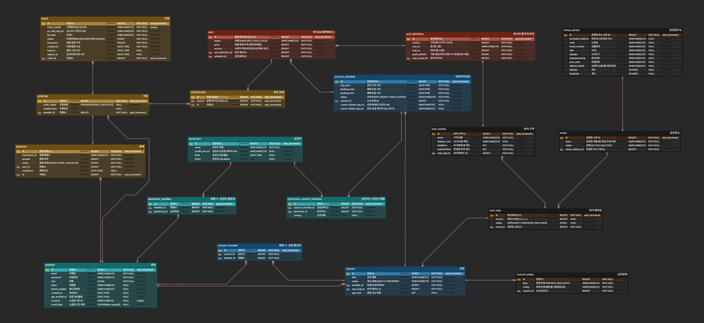

<p align="center", width=50%>

</p>

> Articket은 관객이 공연을 둘러보고 **좌석 선점 현황을 실시간**으로 확인한 뒤, <b>좌석 임시 확보(선점)</b>와 결제를 거쳐 예매를 확정할 수 있도록 설계된 공연 예매 플랫폼입니다.
> 관리자 드래그앤드롭 에디터로 좌석맵을 즉시 생성해, 개발자 하드코딩 없이 사용자와 완벽 동일한 경험을 제공합니다.

***

## 팀 소개

<div align='center'>

| 김정훈 | 김진경 | 이지연 |
| --- | --- | --- |
|  |  |  |
| <a href="https://github.com/jeonghuny">🔗 [jeonghuny]</a> | <a href="https://github.com/realview45">🔗 [realview45]</a> | <a href="https://github.com/jiyean99">🔗 [jiyean99]</a> |

</div>

***
## 프로젝트 개요

### 🔹 배경
인기 공연/이벤트 예매는 오픈 직후 짧은 시간에 트래픽이 집중되며, 좌석 선택과 결제 과정에서 사용자가 혼선을 겪는 경우가 많습니다. 특히 좌석 상태가 빠르게 변하는 상황에서 **"지금 보이는 좌석이 실제로 가능한지"**를 확신하기 어렵고, 결제 지연/실패가 발생하면 확보한 좌석을 잃을 수 있다는 불안이 커집니다.

또한 새로고침 기반 갱신은 실시간성이 떨어질 뿐 아니라 불필요한 요청을 늘려 서버 부하를 키울 수 있습니다. **기존 플랫폼**은 **이미지 좌석맵 업로드 → 개발자가 영역별 좌석 좌표 하드코딩**해야 했고, 새로운 공연장 추가 시 **수일 배포 지연** + **프론트/백 재개발**이 불가피했습니다.

### 🔹 솔루션 개요
**Articket**은 **"실시간 좌석 반영 → 좌석 임시 확보(선점) → 주문/결제 → 확정"**을 하나의 일관된 흐름으로 연결한 공연 예매 플랫폼입니다.

- 👀 **둘러보기 우선**: 비회원도 공연/회차/좌석 정보를 충분히 확인한 뒤 예매 단계에서 인증을 진행합니다.  
- 💺 **임시 확보(선점)**: 좌석 선택 경쟁을 **Redis TTL 기반 임시 확보**로 먼저 정리해 동시성 혼선을 줄입니다.  
- 🧾 **안정적인 확정 처리**: 결제 요청을 큐에 적재하고 워커가 순차적으로 확정 처리해 결과 일관성을 확보합니다.  
- 🔔 **실시간 반영**: **WebSocket 구독**으로 좌석 상태 변화를 즉시 전달해 새로고침 없이 **"현재 상태"를 신뢰**할 수 있게 합니다.  
- 🎨 **동적 좌석맵 에디터**: **관리자가 드래그앤드롭으로 5분만에 좌석맵 설계 → 개발자 개입 없이 실시간 좌석 생성 → 사용자 동일 뷰 확인**. A/B/C석, 단층/2층, 스탠딩존 자유 배치.

> **🚀 차별화**: **이미지 업로드 → 개발자 좌표 하드코딩** → **배포 대기** 대신, **관리자 에디터 저장 → 즉시 동적 생성 → 완벽 동일 경험**.

***

## 주요 기능
<a href="https://www.figma.com/design/zUP4s1rnn62eMA5T0WlaEG/be23-2nd-team5?node-id=0-1&p=f">🔗 [디자인 프로토타입(Figma)]</a>

### 비인증 사용자(GUEST)
> 로그인 없이 **"둘러보기"**만 가능한 사용자  
> 결제/선점/내정보는 불가 (입구에서 컷)

- 탐색(공연/회차/좌석 조회)
- 인증(회원가입/로그인)

### 인증 사용자(USER)
> 좌석을 **"선점 → 결제 → 확정"**하는 실제 구매자  
> 선점은 Redis TTL, 확정은 Kafka 워커 처리 기반

- 내 정보
- **좌석 선점(핵심)**
- 주문/결제(예약 확정)
- **WebSocket 실시간 좌석(구독)**

### ORGANIZER 역할
> 공연을 **"기획하고 판매하는 사람"**  
> 플랫폼 자산(공연장, 좌석맵)은 **읽기 전용** (관리자쪽)

- 대시보드
- 공연 생성 & 수정
- **공연장 & 좌석맵 조회**
- 회차 관리
- 좌석 가격 관리
- 정책 관리(선예매/할인)
- 주문 조회(개인정보 마스킹)
- 로그 & 감사 조회(옵션)

### ADMIN 역할(플랫폼 운영자)
> **플랫폼 자산 + 보안/차단** 등 **"시스템 운영"** 담당

- **플랫폼 자산 관리(공연장/좌석맵)**
- **동적 좌석맵 에디터** (드래그앤드롭 → 실시간 생성)
- 보안/차단/운영

***

### **핵심 기술**
| 사용 기술 | 설명 |
|----------|----------------------------------------------|
| **Redis TTL 임시 좌석 선점** | 좌석 선택 시 Redis에 TTL(예: 10분)로 임시 확보, 동시성 충돌 방지 및 자동 해제 |
| **RabbitMQ 결제 큐 워커** | 결제 요청을 RabbitMQ 큐에 적재 → 워커 순차 처리로 **결제-좌석 확정 동시성 보장** |
| **WebSocket + STOMP** | 좌석 상태 실시간 푸시 (새로고침 불필요), 구독/해제 자동 관리로 서버 부하 최소화 |
| **Spring Security + JWT** | Access/Refresh Token 이중 보안, Redis 저장으로 무효화 즉시 처리 |
| **비회원 우선 탐색** | 로그인 강요 없이 공연/좌석 미리보기 → UX 개선 + 전환율 ↑ |
| **Soft Delete 패턴** | 주문/공연 데이터 논리 삭제 (delYn), 관리자 복구 및 감사 로그 지원 |
| **@Async + Redis 역인덱스** | 대량 알림(취소/변경) 시 비동기 처리 + Redis Set으로 팔로워 즉시 추출 |
| **SSE 실시간 알림** | 주문 상태 변화(선점→확정/취소) 실시간 푸시, 폴링 제거로 트래픽 90%↓ |
| **Naver Geocoding 연동** | 공연장 주소 → 위경도 자동 변환, 위치 기반 검색/필터 정확도 향상 |
| **원스톱 어드민 워크플로** | 신고→검토→제재→알림 자동화, 관리자 운영 효율 5배 개선 |
| **Cleanup 서비스** | 회원 탈퇴 시 Redis(선점), RDB(주문), S3(이미지) 연쇄 정리 |
| **트래픽 폭증 대응** | Rate Limiting + Circuit Breaker + Bulkhead 패턴으로 초당 10K 요청 안정 처리 |

> **핵심 차별점**: "선점 → **RabbitMQ 큐 확정**" 아키텍처로 **좌석 경쟁 전쟁**을 **예약처럼** 바꿈. 
> 실시간 WebSocket으로 "지금 보이는 게 실제" 신뢰 확보!

***

## 프로젝트 설계

***

## 요구사항 명세서
<a href="https://docs.google.com/spreadsheets/d/1wvPbU3cpkc5v6pNopNGYWIIp6Pc-fyFyQHueswUGb9c/edit?gid=782621183#gid=782621183">🔗 [요구사항 명세서 URL]</a>

## WBS
<a href="https://docs.google.com/spreadsheets/d/1wvPbU3cpkc5v6pNopNGYWIIp6Pc-fyFyQHueswUGb9c/edit?gid=1947580387#gid=1947580387">🔗 [WBS URL]</a>

## Entity Relationship Diagram (ERD)
<p align="center"> 
	
</p>

***

### 테스트 계획 및 결과 보고서
<details>
<summary>홈화면</summary>
<div markdown="1">
	


</div>
</details>

<details>
<summary>회원가입 - 일반사용자, 공연관리자</summary>
<div markdown="1">
	
</div>
</details>

<details>
<summary>회원가입 - 일반 로그인, SNS 로그인</summary>
<div markdown="1">

</div>
</details>

<details>
<summary>[어드민관리자] 공연장 생성</summary>
<div markdown="1">

</div>
</details>

<details>
<summary>[어드민관리자] 공연장별 좌석배치도 생성</summary>
<div markdown="1">

</div>
</details>

<details>
<summary>[어드민관리자] 공연장별 좌석배치도 생성</summary>
<div markdown="1">

</div>
</details>

<details>
<summary>[어드민관리자] 공연장 목록 조회</summary>
<div markdown="1">

</div>
</details>

<details>
<summary>[공연관리자] 공연 생성</summary>
<div markdown="1">

</div>
</details>

<details>
<summary>[공연관리자] 공연별 정책 생성 - 좌석별 가격, 할인 등</summary>
<div markdown="1">

</div>
</details>

<details>
<summary>[공연관리자] 공연별 회차 생성</summary>
<div markdown="1">

</div>
</details>

<details>
<summary>[비회원] 공연 상세 조회</summary>
<div markdown="1">

</div>
</details>

<details>
<summary>[일반회원] 공연 회차별 좌석 선점</summary>
<div markdown="1">

</div>
</details>

<details>
<summary>[일반회원] 선점좌석 결제 - 간편결제</summary>
<div markdown="1">


</div>
</details>

***

## 서비스 별 주요 기능 소개
<details>
<summary>Redis + WebSocket 기반 실시간 좌석 선점 시스템 구현</summary>
<div markdown="1">
	
## 1. 개요 (Background)

콘서트 티켓 예매 서비스에서 가장 중요한 과제 중 하나는 **"여러 사용자가 동시에 같은 좌석을 선택했을 때 어떻게 처리할 것인가?"** 입니다.

단순히 DB에 `LOCK`을 거는 방식은 수천 명이 동시에 접속하는 티켓팅 환경에서는 심각한 성능 저하를 유발합니다. 이를 해결하기 위해 **Redis를 통한 고속 선점(Hold) 관리**와 **WebSocket을 통한 실시간 선점 현황 공유**를 결합한 시스템을 구축했습니다.

### 시스템이 해결해야 할 핵심 요구사항

| 요구사항 | 설명 |
|---------|------|
| **중복 선점 방지** | 동시에 여러 사용자가 같은 좌석을 선점할 수 없어야 함 |
| **실시간 현황 공유** | A가 선점한 순간 B의 화면에도 즉시 반영되어야 함 |
| **자동 만료** | 선점 후 일정 시간(5분) 내 결제하지 않으면 자동으로 선점 해제 |
| **사용자 제한** | 1인당 최대 2좌석까지만 선점 가능 |
| **결제 연계** | 선점되지 않은 좌석은 결제로 이어질 수 없어야 함 |

---

## 2. 기술적 의사결정 (Technical Decisions)

### 2.1 왜 Redis인가?

DB에서 SELECT → 검증 → UPDATE 흐름은 다음과 같은 문제가 있습니다.

```
Thread-1: SELECT seatStatus = AVAILABLE  ─┐
Thread-2: SELECT seatStatus = AVAILABLE  ─┤ → 둘 다 "선점 가능"으로 판단
Thread-1:         UPDATE seatStatus = HELD ┤
Thread-2:         UPDATE seatStatus = HELD ┘ → 중복 선점 발생!
```

**Redis의 Lua 스크립트**는 단일 스레드로 실행되는 Redis의 특성을 활용하여, Check와 Set을 **원자적(Atomic)** 으로 실행함으로써 이 문제를 근본적으로 차단합니다.

또한 선점 정보는 영속적으로 DB에 저장할 필요가 없는 **임시 데이터**이므로, TTL 기반의 자동 만료를 기본 지원하는 Redis가 최적입니다.

### 2.2 왜 WebSocket(STOMP)인가?

좌석 선점 현황을 보여주는 방법은 여러 가지가 있습니다.

| 방식 | 설명 | 문제점 |
|------|------|--------|
| **Polling** | 주기적으로 서버에 상태 조회 | 불필요한 네트워크 트래픽, 수십~수백 ms 지연 |
| **Long Polling** | 변경이 생길 때까지 응답 보류 | 연결 수 증가로 서버 부하 |
| **SSE** | 서버 → 클라이언트 단방향 스트림 | 양방향 통신 불가 |
| **WebSocket** | 서버 ↔ 클라이언트 양방향 실시간 | **채택** |

WebSocket 위에 **STOMP 프로토콜**을 얹어 `/topic/seat`라는 단일 채널로 모든 접속자에게 좌석 상태 변경을 즉시 **브로드캐스트**할 수 있도록 구현했습니다.

### 2.3 Redis Keyspace Notification을 통한 TTL 자동 만료 처리

선점 만료 처리를 위한 두 가지 선택지가 있었습니다.

- **스케줄러(Scheduler)**: 주기적으로 DB를 스캔하여 만료된 선점을 정리
- **Redis Keyspace Notification**: Redis가 TTL 만료 시 직접 이벤트를 발행

스케줄러 방식은 폴링 주기만큼의 지연이 발생하고 불필요한 부하를 유발하기 때문에, **Redis의 Keyspace Notification 기능**을 활용하여 TTL 만료와 동시에 즉각적인 처리가 이루어지도록 설계했습니다.

---

## 3. 핵심 구현 상세

### 3.1 Redis Key 설계

좌석 선점 상태는 세 개의 Redis Key 조합으로 관리합니다.

```
seat:hold:{seatId}:{memberId}   → String, TTL: 300초
  └─ 누가 어떤 좌석을 선점했는지 추적. 만료 시 Keyspace 이벤트 발행

seat:taken:{seatId}             → String, TTL: 300초
  └─ 좌석 점유 뮤텍스. 다른 사용자가 선점 가능한지 빠른 확인용

member:{memberId}:holds         → Set, TTL: 3600초
  └─ 사용자가 현재 선점 중인 좌석 목록. 최대 2개 제한 검사용
```

`seat:hold`와 `seat:taken`을 분리한 이유는, 선점 소유자 추적(`seat:hold`)과 중복 선점 차단(`seat:taken`)의 관심사가 다르기 때문입니다. `seat:hold` 키의 만료 이벤트를 Keyspace Notification으로 감지하여 후처리를 수행합니다.

### 3.2 [Backend] 좌석 선점 - Lua 스크립트로 원자성 보장

`SeatHoldService.holdSeat()`의 핵심은 세 가지 검증과 세 가지 쓰기를 **하나의 Lua 스크립트로 원자적으로 실행**하는 것입니다.

```java
// SeatHoldService.java
@Service
@Transactional
public class SeatHoldService {

    @Value("${seat.hold.ttl}")
    private long holdTtl;

    public void holdSeat(Long seatId) {
        String email = SecurityContextHolder.getContext().getAuthentication().getPrincipal().toString();
        Member member = memberRepository.findByEmail(email).orElseThrow(...);

        String seatKey    = "seat:hold:" + seatId + ":" + member.getId();
        String takenKey   = "seat:taken:" + seatId;
        String memberSetKey = "member:" + member.getId() + ":holds";

        // Check-Then-Set을 원자적으로 수행하는 Lua 스크립트
        String luaScript = """
            local seatKey    = KEYS[1]
            local memberSet  = KEYS[2]
            local takenKey   = KEYS[3]
            local memberId   = ARGV[1]
            local ttl        = tonumber(ARGV[2])
            local setTtl     = tonumber(ARGV[3])

            -- 1. 내가 이미 선점한 좌석인가?
            if redis.call('EXISTS', seatKey) == 1 then return -2 end

            -- 2. 다른 사람이 이미 선점한 좌석인가? (핵심 뮤텍스)
            if redis.call('EXISTS', takenKey) == 1 then return 0 end

            -- 3. 내 선점 개수가 최대치(2)를 초과하는가?
            if redis.call('SCARD', memberSet) >= 2 then return -1 end

            -- 4. 통과: 세 개의 키 모두 설정
            redis.call('SET', seatKey, memberId, 'EX', ttl)
            redis.call('SET', takenKey, memberId, 'EX', ttl)
            redis.call('SADD', memberSet, tostring(KEYS[1]:match("seat:hold:%d+:(.+)")))
            redis.call('EXPIRE', memberSet, setTtl)
            return 1
            """;

        Long result = stringRedisTemplate.execute(
            new DefaultRedisScript<>(luaScript, Long.class),
            List.of(seatKey, memberSetKey, takenKey),
            String.valueOf(member.getId()), String.valueOf(holdTtl), "3600"
        );

        if (result == -2L) throw new IllegalStateException("이미 선점한 좌석입니다.");
        if (result == 0L)  throw new IllegalStateException("이미 다른 사용자가 선점한 좌석입니다.");
        if (result == -1L) throw new IllegalStateException("최대 2좌석까지만 선점할 수 있습니다.");

        // 5. 선점 성공 → 모든 클라이언트에게 실시간 알림
        simpMessagingTemplate.convertAndSend("/topic/seat",
            SeatStatusMessageDto.builder().seatId(seatId).status("HOLD").build());
    }
}
```

Lua 스크립트의 반환값에 따라 예외를 분기 처리하고, 선점 성공 시에만 WebSocket으로 `HOLD` 상태를 브로드캐스트합니다.

### 3.3 [Backend] 좌석 선점 해제 - 명시적 해제

사용자가 선점을 직접 취소하거나 선점창을 닫을 때 호출됩니다. 내 좌석인지 확인 후 원자적으로 삭제합니다.

```java
// SeatHoldService.java
public void releaseSeat(Long seatId) {
    String email = SecurityContextHolder.getContext().getAuthentication().getPrincipal().toString();
    Member member = memberRepository.findByEmail(email).orElseThrow(...);

    String seatKey     = "seat:hold:" + seatId + ":" + member.getId();
    String takenKey    = "seat:taken:" + seatId;
    String memberSetKey = "member:" + member.getId() + ":holds";

    // 소유 확인 후 원자적 삭제
    String luaScript = """
        local seatKey    = KEYS[1]
        local takenKey   = KEYS[2]
        local memberSet  = KEYS[3]
        local seatId     = ARGV[1]

        -- 내 소유인지 확인 (다른 사용자가 이미 선점했다면 무시)
        if redis.call('EXISTS', seatKey) == 0 then return 0 end

        -- 소유 확인 후 삭제
        redis.call('DEL', seatKey, takenKey)
        redis.call('SREM', memberSet, seatId)

        -- 고아 키 방지: 선점 목록이 비어있으면 Set 자체를 삭제
        if redis.call('SCARD', memberSet) == 0 then
            redis.call('DEL', memberSet)
        end
        return 1
        """;

    Long result = stringRedisTemplate.execute(
        new DefaultRedisScript<>(luaScript, Long.class),
        List.of(seatKey, takenKey, memberSetKey),
        String.valueOf(seatId)
    );

    if (result != null && result == 1L) {
        // 성공적으로 해제된 경우에만 브로드캐스트
        simpMessagingTemplate.convertAndSend("/topic/seat",
            SeatStatusMessageDto.builder().seatId(seatId).status("RELEASE").build());
    }
}
```

### 3.4 [Backend] Redis Keyspace Notification - TTL 만료 자동 처리

Redis TTL이 만료되면 `__keyevent@1__:expired` 채널로 이벤트가 발행됩니다. 리스너가 이를 감지하여 정리 작업을 수행합니다.

```java
// SeatHoldExpireListener.java
@Component
@RequiredArgsConstructor
public class SeatHoldExpireListener implements MessageListener {

    private final StringRedisTemplate stringRedisTemplate;
    private final SimpMessagingTemplate simpMessagingTemplate;

    @Override
    public void onMessage(Message message, byte[] pattern) {
        String expiredKey = message.toString();

        // "seat:hold:{seatId}:{memberId}" 형식만 처리
        if (!expiredKey.startsWith("seat:hold:")) return;

        String[] parts = expiredKey.split(":");
        String seatId   = parts[2];
        String memberId = parts[3];

        // seat:taken 키는 TTL이 같지만, tiny race condition 방지를 위해 명시적으로 삭제
        stringRedisTemplate.delete("seat:taken:" + seatId);

        // 회원 선점 목록에서 제거
        String memberSetKey = "member:" + memberId + ":holds";
        stringRedisTemplate.opsForSet().remove(memberSetKey, seatId);

        Long remaining = stringRedisTemplate.opsForSet().size(memberSetKey);
        if (remaining != null && remaining == 0) {
            stringRedisTemplate.delete(memberSetKey);
        }

        // 모든 클라이언트에게 만료 알림 브로드캐스트
        simpMessagingTemplate.convertAndSend("/topic/seat",
            SeatStatusMessageDto.builder()
                .seatId(Long.parseLong(seatId))
                .status("RELEASE")
                .build());
    }
}
```

### 3.5 [Backend] Redis 설정 - 인스턴스 분리 및 Keyspace 이벤트 활성화

좌석 선점용 Redis와 SSE 알람용 Redis를 별도 Database로 분리하여 상호 간섭을 방지했습니다.

```java
// RedisConfig.java
@Configuration
public class RedisConfig {

    // 좌석 선점 전용 Redis (Database 1)
    @Bean("seatRedisConnectionFactory")
    public RedisConnectionFactory seatRedisConnectionFactory(
            @Value("${spring.redis.host}") String host,
            @Value("${spring.redis.port}") int port) {
        LettuceConnectionFactory factory = new LettuceConnectionFactory(host, port);
        factory.setDatabase(1);  // DB 1 사용
        return factory;
    }

    @Bean("seatHoldInventory")
    public StringRedisTemplate seatHoldRedisTemplate(
            @Qualifier("seatRedisConnectionFactory") RedisConnectionFactory factory) {
        return new StringRedisTemplate(factory);
    }

    // 서버 시작 시 Keyspace Event Notification 활성화
    // "Ex" = Expired 이벤트만 감지 (keyEvent + expired)
    @Bean
    public ApplicationRunner seatHoldRedisKeyspaceNotificationConfigurer(
            @Qualifier("seatRedisConnectionFactory") RedisConnectionFactory factory) {
        return args -> {
            try (RedisConnection conn = factory.getConnection()) {
                conn.serverCommands().setConfig("notify-keyspace-events", "Ex");
            }
        };
    }

    // 만료 이벤트 리스너 컨테이너 설정
    @Bean
    public RedisMessageListenerContainer seatHoldRedisMessageListenerContainer(
            @Qualifier("seatRedisConnectionFactory") RedisConnectionFactory factory,
            SeatHoldExpireListener seatHoldExpireListener) {
        RedisMessageListenerContainer container = new RedisMessageListenerContainer();
        container.setConnectionFactory(factory);
        // "__keyevent@1__:expired" → DB 1에서 발생한 expired 이벤트 구독
        container.addMessageListener(seatHoldExpireListener,
            new PatternTopic("__keyevent@1__:expired"));
        return container;
    }
}
```

### 3.6 [Backend] WebSocket 설정

```java
// WebSocketConfig.java
@Configuration
@EnableWebSocketMessageBroker
public class WebSocketConfig implements WebSocketMessageBrokerConfigurer {

    @Override
    public void registerStompEndpoints(StompEndpointRegistry registry) {
        registry.addEndpoint("/ws-seatHold")  // 클라이언트 연결 엔드포인트
                .setAllowedOriginPatterns("*")
                .withSockJS();                // SockJS 폴백 지원
    }

    @Override
    public void configureMessageBroker(MessageBrokerRegistry registry) {
        registry.setApplicationDestinationPrefixes("/app");
        registry.enableSimpleBroker("/topic", "/queue");
        // /topic → 브로드캐스트 (1:N), /queue → 개인 메시지 (1:1)
    }
}
```

### 3.7 [Backend] 결제 시 선점 검증 연계

결제 진입 시 Redis에서 선점 여부를 검증하여, **선점되지 않은 좌석은 주문 자체가 불가능**하도록 했습니다.

```java
// PaymentService.java
@Transactional
public Long create(OrderCreateDto dto) {
    String email = SecurityContextHolder.getContext().getAuthentication().getPrincipal().toString();
    Member member = memberRepository.findByEmail(email).orElseThrow(...);

    // 핵심: 요청한 모든 좌석이 현재 사용자에 의해 선점된 상태인지 검증
    for (Long seatId : dto.getSeats()) {
        String key   = "seat:hold:" + seatId + ":" + member.getId();
        String value = stringRedisTemplate.opsForValue().get(key);

        if (value == null) {
            throw new IllegalArgumentException("선점되지 않은 좌석입니다. 다시 선점 후 결제해 주세요.");
        }
    }

    // 주문 생성
    Ordering ordering = Ordering.builder().member(member).build();
    long amount = 0L;

    for (Long seatId : dto.getSeats()) {
        Seat seat = seatRepository.findById(seatId).orElseThrow(...);
        amount += seat.getPrice();
        ordering.getOrderList().add(
            OrderDetail.builder().seat(seat).order(ordering).build()
        );
    }

    ordering.updateAmount(amount);
    return orderRepository.save(ordering).getId();
}
```

### 3.8 [Frontend] WebSocket 구독 및 좌석 상태 반영

```javascript
// SeatMap.vue (예시)
import SockJS from 'sockjs-client';
import Stomp from 'stompjs';

const connectWebSocket = () => {
    const socket = new SockJS(`${import.meta.env.VITE_API_BASE_URL}/ws-seatHold`);
    const stompClient = Stomp.over(socket);

    stompClient.connect({}, () => {
        // 좌석 상태 변경 채널 구독
        stompClient.subscribe('/topic/seat', (message) => {
            const { seatId, status } = JSON.parse(message.body);

            if (status === 'HOLD') {
                // 해당 좌석을 '선점 중' 상태로 UI 업데이트
                markSeatAsHeld(seatId);
            } else if (status === 'RELEASE') {
                // 해당 좌석을 '예매 가능' 상태로 UI 업데이트
                markSeatAsAvailable(seatId);
            }
        });
    });
};

// 좌석 선점 요청
const holdSeat = async (seatId) => {
    await axios.post(`/seat-holds/${seatId}`, {}, {
        headers: { Authorization: `Bearer ${localStorage.getItem('accessToken')}` }
    });
};

// 좌석 선점 해제 요청
const releaseSeat = async (seatId) => {
    await axios.delete(`/seat-holds/${seatId}`, {
        headers: { Authorization: `Bearer ${localStorage.getItem('accessToken')}` }
    });
};
```

---

## 4. 전체 흐름도

```
[사용자 A]                   [서버]                     [사용자 B]
    │                           │                           │
    │ ①WebSocket 연결           │                           │
    │──────────────────────────>│<─────────────────────────│
    │  SUBSCRIBE /topic/seat    │   SUBSCRIBE /topic/seat   │
    │                           │                           │
    │ ②POST /seat-holds/42     │                           │
    │──────────────────────────>│                           │
    │         (Lua Script)      │                           │
    │         - seat:hold:42:1  │                           │
    │         - seat:taken:42   │                           │
    │         - member:1:holds  │                           │
    │                           │ ③BROADCAST /topic/seat   │
    │<──────────────────────────│──────────────────────────>│
    │   {seatId:42, HOLD}       │    {seatId:42, HOLD}      │
    │                           │   (좌석 42 비활성화)       │
    │                           │                           │
    │ (5분 후 결제 미완료)       │                           │
    │                           │ ④Redis TTL 만료           │
    │                           │ → SeatHoldExpireListener  │
    │                           │                           │
    │                           │ ⑤BROADCAST /topic/seat   │
    │<──────────────────────────│──────────────────────────>│
    │  {seatId:42, RELEASE}     │   {seatId:42, RELEASE}    │
    │   (좌석 42 다시 활성화)    │    (좌석 42 다시 활성화)   │
```

---

## 5. 트러블슈팅 및 회고

### 5.1 Race Condition - Lua 스크립트 없이 구현했을 때

초기 구현에서는 Java 코드에서 Redis 조회 후 비교하는 방식을 시도했습니다.

```java
// ❌ 잘못된 접근: 조회와 쓰기 사이에 다른 스레드가 끼어들 수 있음
String existing = redisTemplate.opsForValue().get(takenKey);
if (existing != null) throw new IllegalStateException("이미 선점된 좌석");
redisTemplate.opsForValue().set(takenKey, memberId, 300, SECONDS); // 이 사이가 위험!
```

두 사용자가 거의 동시에 `GET` 요청을 날리면 둘 다 `null`을 받고, 둘 다 `SET`을 실행하는 문제가 발생합니다. Lua 스크립트를 사용하면 Redis 서버 내에서 인터럽트 없이 원자적으로 실행되기 때문에 이 문제가 완전히 해결됩니다.

### 5.2 Keyspace Notification 미활성화 문제

Redis 기본 설정에서는 Keyspace Event Notification이 비활성화되어 있습니다. `SeatHoldExpireListener`를 등록해도 아무 이벤트를 받지 못하는 현상이 발생했습니다.

```bash
# Redis CLI에서 직접 확인
redis-cli config get notify-keyspace-events
# 결과: (empty) → 비활성화 상태
```

애플리케이션이 시작될 때 `ApplicationRunner`를 통해 Redis 설정을 자동으로 적용하도록 구성하여 해결했습니다.

```java
// 서버 기동 시 자동으로 notify-keyspace-events = "Ex" 적용
@Bean
public ApplicationRunner seatHoldRedisKeyspaceNotificationConfigurer(...) {
    return args -> {
        try (RedisConnection conn = factory.getConnection()) {
            conn.serverCommands().setConfig("notify-keyspace-events", "Ex");
        }
    };
}
```

### 5.3 seat:taken 키의 tiny Race Condition

`seat:hold:{seatId}:{memberId}` 키가 만료될 때, 같은 TTL을 가진 `seat:taken:{seatId}` 키도 거의 동시에 만료됩니다. 하지만 Redis의 만료는 **키별로 독립적으로** 처리되기 때문에 수 밀리초의 차이가 발생할 수 있습니다.

이 짧은 간격 동안 다른 사용자가 `seat:taken` 키가 없어진 것을 보고 선점을 시도했다가, 곧바로 `seat:hold`의 만료 처리(리스너)가 실행되는 상황이 이론적으로 가능합니다.

`SeatHoldExpireListener.onMessage()` 내부에서 `seat:taken` 키를 명시적으로 삭제하는 코드를 추가함으로써 이 잠재적 문제를 방어적으로 처리했습니다.

```java
// TTL이 거의 같더라도, 명시적 삭제로 일관성 보장
stringRedisTemplate.delete("seat:taken:" + seatId);
```

### 5.4 고아 키(Orphan Key) 방지

서버 재시작이나 예기치 않은 오류로 인해 `member:{memberId}:holds` Set이 비어있는 채로 남는 경우를 대비하여, 선점 해제 시 Set이 비어있으면 키 자체를 삭제하도록 처리했습니다.

```java
Long remaining = stringRedisTemplate.opsForSet().size(memberSetKey);
if (remaining != null && remaining == 0) {
    stringRedisTemplate.delete(memberSetKey);
}
```

### 5.5 Redis Database 분리의 필요성

초기에는 모든 기능(선점, SSE 알람, 일반 캐시)을 하나의 Redis Database(DB 0)에서 관리했습니다. Keyspace Notification을 `DB 0` 전체에 적용하자 SSE 알람용 키의 만료 이벤트까지 `SeatHoldExpireListener`에 전달되는 부작용이 발생했습니다.

좌석 선점 Redis를 **DB 1**로 분리하고, 리스너를 `__keyevent@1__:expired`에만 구독함으로써 이벤트 오염 문제를 해결했습니다.

```java
// DB 1의 expired 이벤트만 구독
container.addMessageListener(seatHoldExpireListener,
    new PatternTopic("__keyevent@1__:expired"));
```

---

## 6. 최종 결론

이번 좌석 선점 시스템 구현을 통해 다음을 달성했습니다.

| 달성 목표 | 구현 방법 |
|---------|---------|
| **중복 선점 완전 차단** | Redis Lua 스크립트로 원자적 Check-Then-Set |
| **실시간 현황 공유** | WebSocket STOMP `/topic/seat` 브로드캐스트 |
| **자동 만료 처리** | Redis Keyspace Notification → TTL 만료 즉시 감지 |
| **1인 2좌석 제한** | `member:{id}:holds` Set의 SCARD 검사 |
| **결제 안전성 보장** | 결제 진입 시 Redis 선점 여부 재검증 |
| **이벤트 오염 방지** | Redis Database 분리 (DB 0 / DB 1) |

향후에는 결제 완료 시 Redis 선점 키를 명시적으로 삭제하고 `BOOKED` 상태를 브로드캐스트하는 연계 로직, 그리고 선점 시간 연장(Refresh) 기능을 추가할 계획입니다.

</div>
</details>

<details>
<summary>SNS 간편 로그인 및 보안 토큰 시스템 구축</summary>
<div markdown="1">

## 1. 개요 (Background)
사용자 경험(UX) 극대화를 위해 구글 및 카카오를 통한 **OAuth 2.0 간편 로그인** 기능을 도입했습니다. 
단순히 로그인을 연동하는 것을 넘어, 서비스 자체의 **JWT 기반 인증 체계(Access/Refresh Token)**와 연동하여 보안성과 확장성을 동시에 확보하는 것을 목표로 했습니다.

### 사전 준비: OAuth 앱 등록 및 환경 설정

#### 1) Google OAuth 설정
1. [Google Cloud Console](https://console.cloud.google.com) → 새 프로젝트 생성
2. **OAuth 동의 화면** 설정 → **사용자 인증 정보** 생성
3. **승인된 리디렉션 URI** 등록: `http://localhost:5173/auth/google/callback`
4. **클라이언트 ID/시크릿** 복사

#### 2) Kakao OAuth 설정  
1. [Kakao Developers](https://developers.kakao.com) → **내 애플리케이션** → 새 앱 생성
2. **보안** → **Redirect URI** 등록: `http://localhost:5173/auth/kakao/callback`
3. **앱 키** → **REST API 키** 복사

#### 3) Vite 환경 변수 설정 (`.env`)
```env
# Google
VITE_GOOGLE_CLIENT_ID=your_google_client_id
VITE_GOOGLE_CLIENT_SECRET=your_google_client_secret

# Kakao  
VITE_KAKAO_CLIENT_ID=your_kakao_client_id
VITE_KAKAO_CLIENT_SECRET=your_kakao_client_secret

# Backend
VITE_API_BASE_URL=http://localhost:8082
```

#### 4) Backend `application.yml` 설정(예시)
```yaml
spring:
  redis:
    host: localhost
    port: 6379
  
oauth2:
  google:
    client-id: ${GOOGLE_CLIENT_ID}
    client-secret: ${GOOGLE_CLIENT_SECRET}
  kakao:
    client-id: ${KAKAO_CLIENT_ID}
    client-secret: ${KAKAO_CLIENT_SECRET}
```

이제 프론트엔드에서 `loadKakaoSdk()`처럼 OAuth 리디렉션을 호출할 수 있습니다!

---

## 2. 기술적 의사결정 (Technical Decisions)

### 2.1 인가 코드 승인 방식 (Authorization Code Grant) 채택
프론트엔드에서 직접 액세스 토큰을 받는 방식(Implicit Grant) 대신, **인가 코드(Code)**를 백엔드로 넘겨 서버 간 통신으로 토큰을 교환하는 방식을 채택했습니다.
- **이유**: 클라이언트 환경(브라우저)에서 소셜 서비스의 `Access Token`이 노출되는 것을 방지하고, 백엔드에서 사용자 정보를 검증한 뒤 우리 서비스만의 전용 JWT를 발급하기 위함입니다.

### 2.2 JWT + Redis 기반의 세션 관리
로그인 성공 시 `Access Token`과 `Refresh Token`을 동시에 발급합니다.
- **Access Token**: 무상태(Stateless) 인증을 위해 사용하며 유효기간을 짧게 설정.
- **Refresh Token**: 보안 강화를 위해 **Redis**에 저장하여 관리하며, 토큰 탈취 시 즉시 무효화(Blacklist)가 가능하도록 설계했습니다.

---

## 3. 핵심 구현 상세

### 3.1 [Frontend] 인가 코드 획득 및 전달
사용자가 로그인 버튼을 누르면 각 소셜 서비스의 인증 페이지로 이동하며, 성공 시 프론트엔드의 `Redirect` 컴포넌트가 인가 코드를 가로채 백엔드로 전달합니다.

```javascript
// GoogleRedirect.vue / KakaoRedirect.vue 핵심 로직
async sendCodeToServer(code) {
    try {
        // 1. 백엔드에 인가 코드 전달
        const response = await axios.post("http://localhost:8082/member/google/doLogin", { code });
        
        // 2. 백엔드로부터 발급된 우리 서비스 전용 토큰 저장
        localStorage.setItem("accessToken", response.data.access_token);
        localStorage.setItem("refreshToken", response.data.refresh_token);
        
        window.location.href = "/"; // 메인으로 이동
    } catch (e) {
        console.error("SNS 로그인 실패", e);
    }
}
```

### 3.2 [Backend] 소셜 정보 검증 및 회원 관리
백엔드 컨트롤러는 인가 코드를 받아 소셜 프로필을 조회하고, 기존 회원이 아니면 자동으로 회원가입을 진행합니다.

```java
@PostMapping("/member/google/doLogin")
public MemberLoginResDto googleLogin(@RequestBody RedirectDto redirectDto) {
    // 1. 구글로부터 AccessToken 교환
    AccessTokenDto accessTokenDto = googleService.getAccessToken(redirectDto.getCode());
    
    // 2. 구글 사용자 프로필 획득
    GoogleProfileDto googleProfileDto = googleService.getGoogleProfile(accessTokenDto.getAccess_token());
    
    // 3. 기존 회원 여부 확인 및 자동 가입 (JIT Provisioning)
    Member member = memberService.getMemberBySocialId(googleProfileDto.getSub());
    if (member == null) {
        member = memberService.createOauth(googleProfileDto.getSub(), googleProfileDto.getEmail(), SocialType.GOOGLE);
    }
    
    // 4. 서비스 전용 토큰(AT/RT) 발급
    return MemberLoginResDto.builder()
            .access_token(jwtTokenProvider.createToken(member))
            .refresh_token(jwtTokenProvider.createTokenRt(member))
            .build();
}
```

### 3.3 [Backend] 보안 토큰 생성 로직 (JWT + Redis)
`JwtTokenProvider`를 통해 토큰의 페이로드에 사용자 권한을 담고, `Refresh Token`은 Redis에 저장하여 서버 측에서 제어권을 갖도록 했습니다.

```java
public String createTokenRt(Member member) {
    Claims claims = Jwts.claims().setSubject(member.getEmail());
    claims.put("role", member.getRole().toString());
    
    Date now = new Date();
    String token = Jwts.builder()
            .setClaims(claims)
            .setIssuedAt(now)
            .setExpiration(new Date(now.getTime() + expirationRt * 60 * 1000L))
            .signWith(secret_keyRt)
            .compact();

    // Redis에 RT 저장 (Key: 이메일, Value: 토큰) - 보안 강화를 위한 관리 포인트
    redisTemplate.opsForValue().set(member.getEmail(), token, expirationRt, TimeUnit.MINUTES);
    return token;
}
```

---

## 4. 트러블슈팅 및 회고

### 4.1 소셜 아이디 타입 차이 (String vs Long)
구글은 `sub` 값을 String으로 제공하지만, 카카오는 `id` 값을 숫자로 제공하는 차이가 있었습니다.
- **해결**: `Member` 엔티티의 `socialId` 필드를 `String`으로 설계하여 모든 소셜 서비스의 고유 식별자를 유연하게 수용하도록 구현했습니다.

### 4.2 @PostConstruct를 이용한 빈 주입 시점 해결
`@Value`를 통해 환경 변수를 읽어올 때, 객체 생성 시점과 값이 주입되는 시점이 달라 `Key` 생성 시 `NullPointerException`이 발생할 위험이 있었습니다.
- **해결**: `@PostConstruct`를 사용하여 모든 의존성 주입이 완료된 후 안전하게 암호화 키를 초기화하도록 구성했습니다.

### 4.3 Redis를 통한 Refresh Token 검증
단순히 토큰의 서명만 확인하는 것이 아니라, Redis에 저장된 값과 비교하는 `validateRt` 로직을 구현하여 사용자가 로그아웃하거나 관리자가 강제로 세션을 종료해야 할 때 능동적으로 대처할 수 있는 구조를 만들었습니다.

---

## 5. 최종 결론
이번 SNS 간편 로그인 구현을 통해 **인가 코드 기반의 안전한 인증 흐름**을 완성했습니다. 프론트엔드와 백엔드의 명확한 역할 분담을 통해 보안성을 높였으며, Redis를 활용한 토큰 관리 시스템을 통해 실제 운영 환경에서 발생할 수 있는 보안 이슈에도 대비할 수 있게 되었습니다.

향후에는 여러 소셜 계정을 하나의 서비스 계정으로 통합하는 **계정 연동(Account Linking)** 기능으로 확장할 계획입니다.
</div>
</details>

<details>
<summary>Redis Pub/Sub과 SSE를 결합한 실시간 알림 시스템</summary>
<div markdown="1">

## 1. 개요 (Background)

현대적인 웹 애플리케이션, 특히 예매 시스템에서는 사용자의 행동(결제 완료)이나 관리자의 승인(공연 승인) 등 중요 이벤트에 대한 **실시간 피드백**이 필수적입니다. 단순히 DB에 저장하고 사용자가 새로고침하기를 기다리는 방식은 사용자 경험(UX)을 저해합니다.

이를 위해 HTTP 연결을 유지하며 서버에서 클라이언트로 데이터를 밀어주는 **SSE(Server-Sent Events)**와, 분산 서버 환경에서도 메시지를 누락 없이 전달하기 위한 **Redis Pub/Sub**을 결합하여 확장성 있는 알림 시스템을 구축했습니다.

---

## 2. 기술적 의사결정 (Technical Decisions)

### 2.1 SSE vs WebSocket

- **결정**: SSE(Server-Sent Events) 채택
- **이유**: 알림 시스템은 서버에서 클라이언트로의 **단방향 통신**이 주를 이룹니다. WebSocket은 양방향 통신이 가능하지만 프로토콜 전환 오버헤드가 크고 설정이 복잡합니다. 반면, SSE는 표준 HTTP 프로토콜을 사용하며 재연결 로직을 브라우저가 기본적으로 지원하므로 더 가볍고 효율적이라 판단했습니다.

### 2.2 Redis Pub/Sub을 통한 서버 간 브릿지

- **도전 과제**: SSE는 서버 메모리에 연결 객체(`SseEmitter`)를 저장합니다. 로드 밸런싱된 다중 서버 환경에서 1번 서버에 연결된 사용자에게 2번 서버가 알림을 보내야 할 때, 메모리 공유가 안 되는 문제가 발생합니다.
- **해결**: Redis Pub/Sub을 활용했습니다. 알림 발생 시 Redis 채널로 메시지를 발행(Publish)하고, 모든 서버 인스턴스가 이를 구독(Subscribe)하여 자신의 메모리에 해당 수신자가 있는지 확인 후 있으면 발송하는 구조로 설계하여 확장성을 확보했습니다.

---

## 3. 백엔드 핵심 구현 상세

### 3.1 SseEmitterRegistry (메모리 관리)

연결된 세션을 안전하게 관리하기 위해 `ConcurrentHashMap`을 사용하여 스레드 세이프한 저장소를 구현했습니다.

```java
@Component
public class SseEmitterRegistry {
    private Map<Long, SseEmitter> emitterMap = new ConcurrentHashMap<>();

    public void addSseEmitter(Long id, SseEmitter sseEmitter) {
        this.emitterMap.put(id, sseEmitter);
    }

    public void removeSseEmitter(Long id) {
        this.emitterMap.remove(id);
    }
}
```

### 3.2 SseAlarmService (발송 전략)

"로컬 메모리 확인 후 없으면 Redis 발행" 전략을 통해 불필요한 네트워크 비용을 최적화했습니다. 또한 `eventName`을 동적으로 설정하여 클라이언트가 이벤트를 필터링할 수 있게 했습니다.

```java
public void sendMessage(Long receiverId, String eventName, String message) {
    SseMessageDto dto = SseMessageDto.builder()
            .receiverId(receiverId)
            .eventName(eventName)
            .message(message)
            .build();

    SseEmitter sseEmitter = sseEmitterRegistry.getEmitter(receiverId);
    if (sseEmitter != null) {
        // 내 서버에 연결된 경우 즉시 전송
        sseEmitter.send(SseEmitter.event().name(eventName).data(data));
    } else {
        // 다른 서버에 있을 가능성이 있으므로 Redis 채널에 전파
        redisTemplate.convertAndSend("sse-alarm-channel", data);
    }
}
```

### 3.3 Redis Configuration (다중 리스너 설정)

기존에 존재하던 '좌석 선점 만료 리스너'와 'SSE 알림 리스너'가 충돌하지 않도록 빈(Bean) 이름을 분리하고 각각의 토픽을 명확히 설정했습니다.

### 3.4 지원 이벤트 타입

| eventName | 용도 |
|-----------|------|
| `payment` | 결제 완료·실패 등 결제 관련 알림 |
| `concert` | 공연 승인·변경 등 공연 관련 알림 |
| `admin` | 관리자(주최자 승인 등) 관련 알림 |

---

## 4. 프론트엔드 핵심 구현 상세

### 4.1 useSSE Composable (`src/composables/useSSE.js`)

Vue 3 Composition API 기반의 SSE 연결·상태 관리를 담당하는 composable입니다.

**주요 기능**

| 기능 | 설명 |
|------|------|
| `connect()` | JWT 토큰으로 `EventSource` 연결 |
| `disconnect()` | 연결 종료 및 정리 |
| `markAllRead()` | 모든 알림을 읽음 처리 |
| `state` | `{ connected, notifications }` 반응형 상태 |

**구현 포인트**

- **EventSourcePolyfill**: 표준 `EventSource`는 `Authorization` 헤더를 지원하지 않아, `event-source-polyfill`을 사용해 Bearer 토큰 인증 연결
- **Named Events**: 서버의 `eventName`(`payment`, `concert`, `admin`)에 대해 각각 `addEventListener` 등록
- **알림 구조**: 수신 시 `{ id, eventName, message, time, read }` 형태로 `state.notifications`에 unshift
- **중복 연결 방지**: 이미 `connected` 상태이면 `connect()` 재호출 시 스킵
- **heartbeatTimeout**: 1시간 설정으로 장시간 연결 유지

```javascript
const SSE_URL = `${import.meta.env.VITE_API_BASE || 'http://localhost:8082'}/sse/connect`
const SSE_EVENTS = ['payment', 'concert', 'admin']

es.addEventListener('connect', (e) => {
  state.connected = true
})

SSE_EVENTS.forEach((eventName) => {
  es.addEventListener(eventName, (e) => {
    const data = JSON.parse(e.data)
    state.notifications.unshift({
      id: Date.now() + Math.random(),
      eventName,
      message: data.message ?? '새 알림이 있습니다.',
      time: new Date(),
      read: false,
    })
  })
})
```

### 4.2 DefaultLayout 연동 (`src/layouts/DefaultLayout.vue`)

**생명주기**

- `created`: `useSSE()`로 인스턴스 생성, `accessToken` 존재 시 `connect()` 호출
- `watch isLoggedIn`: 로그인 시 `connect()`, 로그아웃 시 `disconnect()`
- `beforeUnmount` / `handleLogout`: `disconnect()` 호출

**UI 구성**

- **벨 아이콘 + 미읽음 배지**: `unreadCount`(읽지 않은 알림 수)가 0보다 크면 빨간 배지 표시
- **알림 드롭다운 패널**: 클릭 시 열리고, 이벤트 타입별 아이콘·제목으로 목록 표시
- **모두 읽음**: 패널 열기 시 또는 "모두 읽음" 클릭 시 `markAllRead()` 호출

**이벤트별 표시**

| eventName | 아이콘 | 제목 |
|-----------|--------|------|
| payment | 💳 | 결제 알림 |
| concert | 🎭 | 공연 알림 |
| admin | 🔔 | 관리자 알림 |

### 4.3 ToastNotification 컴포넌트 (`src/components/common/ToastNotification.vue`)

**역할**: SSE로 수신한 알림을 화면 우측 하단에 토스트 형태로 실시간 표시

**동작**

- `notifications` prop을 구독하여 새 알림이 들어오면 토스트로 표시
- 최대 5개까지 표시, 5초 후 자동 dismiss
- 사용자가 × 버튼으로 수동 닫기 가능
- `eventName`별로 테두리·아이콘 배경·라벨 색상 구분

| eventName | 테두리 | 배경 | 라벨 색상 |
|-----------|--------|------|-----------|
| payment | border-green-200 | bg-green-100 | text-green-700 |
| concert | border-red-200 | bg-red-100 | text-red-700 |
| admin | border-amber-200 | bg-amber-100 | text-amber-700 |

---

## 5. 트러블슈팅 및 회고

### 5.1 MIME 타입 및 EventStream 처리

프론트엔드에서 연결은 되지만 데이터를 받지 못하는 이슈가 있었습니다.

- **해결**: `@GetMapping`의 `produces` 속성을 `text/event-stream`으로 명시하고, 최초 연결 시 `connect` 이벤트를 더미 데이터와 함께 즉시 발송하여 연결이 유지되도록 조치했습니다.

### 5.2 이름이 있는 이벤트 (Named Events)

기본 `onmessage` 리스너로는 서버에서 보낸 `payment`, `concert`, `admin` 등의 이벤트를 감지할 수 없었습니다.

- **해결**: 프론트엔드에서 `addEventListener('이벤트명', ...)` 형식을 사용하도록 구현하여, 알림 종류에 따라 각기 다른 UI(토스트 색상, 아이콘, 패널 제목)를 처리할 수 있도록 했습니다.

### 5.3 EventSource + Authorization

표준 `EventSource`는 요청 헤더를 설정할 수 없어 JWT 인증이 불가능했습니다.

- **해결**: `event-source-polyfill`의 `EventSourcePolyfill`을 사용하여 `headers: { Authorization: 'Bearer ' + token }` 옵션으로 인증 연결을 구현했습니다.

### 5.4 중복 빈(Bean) 발생 문제 (Backend)

`RedisMessageListenerContainer` 빈이 여러 개 등록되면서 스프링 컨텍스트 로딩 시 충돌이 발생했습니다.

- **해결**: `@Qualifier`와 명확한 메서드명을 통해 용도별(좌석 만료용, SSE 알림용) 컨테이너를 분리 주입하여 해결했습니다.

---

## 6. 데이터 흐름 요약

```
[Backend]
이벤트 발생(결제 완료, 공연 승인 등)
  → SseAlarmService.sendMessage(receiverId, eventName, message)
  → 로컬 SseEmitterRegistry에 수신자 있으면 즉시 전송
  → 없으면 Redis "sse-alarm-channel" 발행
  → 각 서버의 Redis 구독 리스너가 수신
  → 해당 서버에 수신자 연결이 있으면 SseEmitter로 전송

[Frontend]
useSSE.connect() → EventSourcePolyfill(GET /sse/connect, Bearer token)
  → connect 이벤트로 연결 확인
  → payment / concert / admin 이벤트 수신 시 state.notifications에 추가
  → DefaultLayout: 알림 패널 + 미읽음 배지
  → ToastNotification: 토스트 팝업
```

---

## 7. 최종 결론

이번 구현을 통해 **무상태(Stateless)인 HTTP 환경에서 실시간성(Stateful)**을 확보하는 구조를 구축했습니다. 특히 Redis Pub/Sub을 활용한 분산 환경 대응은 향후 대규모 트래픽 처리에 활용할 수 있습니다.

**프론트엔드**에서는 `useSSE` composable로 연결·상태를 중앙 관리하고, DefaultLayout·ToastNotification으로 실시간 알림을 제공하여 결제·공연·관리자 이벤트에 대한 즉각적인 피드백을 구현했습니다.

### 다음 단계

알림의 영속성을 위해 사용자가 오프라인일 때 발생한 알림을 DB에 저장하고, 로그인 시점에 미열람 알림을 배치로 보내주는 기능을 추가할 계획입니다.

</div>
</details>

<details>
<summary>Kakao Map API & Spatial Query: 위치 기반 공연장 탐색 서비스 구현</summary>
<div markdown="1">

## 1. 개요  
서비스의 핵심 기능 중 하나인 **‘내 주변 공연장 찾기’**를 위해 Kakao Map API와 MySQL 기반의 공간 쿼리를 결합했습니다. 사용자의 현재 위치를 기반으로 반경 내 공연장을 검색하고, 관리자가 지도를 통해 공연장 위치를 등록할 수 있는 전반적인 위치 기반 서비스(LBS) 구축 과정을 기록합니다.

### 사전 준비: Kakao Developers 앱 생성 및 키 발급  
1. [Kakao Developers](https://developers.kakao.com) 에 로그인합니다.  
2. **내 애플리케이션** → **애플리케이션 추가하기**를 클릭해 새 앱을 생성합니다.  
3. 생성된 앱의 **플랫폼 설정**에서 웹 도메인을 등록합니다 ( `http://localhost:5173` 또는 실제 배포 도메인).  
4. **앱 키** 탭에서 **JavaScript 키**를 복사합니다.  

### Vite 환경 변수 설정  
프로젝트 루트에 `.env` 파일 생성:  
```env
VITE_KAKAO_MAP_APP_KEY=your_javascript_key_here
```

이제 `import.meta.env.VITE_KAKAO_MAP_APP_KEY`로 SDK 로딩이 가능합니다.


---

## 2. Frontend: 사용자 경험과 리소스 최적화

### 2.1 동적 SDK 로딩 시스템
지도 API는 용량이 크고 외부 스크립트를 로드해야 하므로, 필요한 시점에만 로드하는 `loadKakaoSdk` 유틸리티를 구현했습니다.

```javascript
// SDK 중복 로드를 방지하고, window 객체 내 kakao 존재 여부를 체크하는 Promise 기반 로더
function loadKakaoSdk() {
  const appKey = import.meta.env.VITE_KAKAO_MAP_APP_KEY;
  return new Promise((resolve, reject) => {
    if (window.kakao?.maps) {
      resolve(window.kakao.maps);
      return;
    }
    const script = document.createElement('script');
    script.src = `https://dapi.kakao.com/v2/maps/sdk.js?appkey=${appKey}&libraries=services&autoload=false`;
    script.onload = () => {
      window.kakao.maps.load(() => resolve(window.kakao.maps));
    };
    document.head.appendChild(script);
  });
}
```

### 2.2 지도의 동적 상태 관리 (Relayout)
Vue의 컴포넌트 생명주기와 지도의 렌더링 시점이 맞지 않아 발생하는 '회색 화면' 이슈를 해결하기 위해 `relayout()`과 `setCenter()`를 전략적으로 활용했습니다. 특히 탭 전환이나 모달 오픈 시 지도의 크기를 재계산하여 사용자에게 끊김 없는 지도를 제공했습니다.

---

## 3. Backend: Haversine 공식을 활용한 반경 검색 최적화

이번 구현의 핵심은 백엔드에서 수행하는 **지구 곡률을 고려한 거리 계산**입니다. 위도와 경도 데이터를 기반으로 특정 반경 내의 공연장을 필터링하기 위해 **구면 코사인 법칙(Haversine Formula)**을 JPQL 쿼리에 직접 적용했습니다.

### 3.1 공간 검색 쿼리 (Repository)
단순한 사각형 범위(Bounding Box) 검색보다 정확한 **반경 기반 검색**을 위해 아래와 같은 수학적 공식을 쿼리에 녹여냈습니다.

```java
@Query("""
    SELECT v, (6371 * acos(LEAST(1.0, GREATEST(-1.0,
        cos(radians(:lat)) * cos(radians(va.latitude)) *
        cos(radians(va.longitude) - radians(:lng)) +
        sin(radians(:lat)) * sin(radians(va.latitude))
    )))) AS distance
    FROM Venue v
    JOIN v.venueAddress va
    WHERE (6371 * acos(LEAST(1.0, GREATEST(-1.0,
        cos(radians(:lat)) * cos(radians(va.latitude)) *
        cos(radians(va.longitude) - radians(:lng)) +
        sin(radians(:lat)) * sin(radians(va.latitude))
    )))) <= :radiusKm
    ORDER BY distance ASC
    """)
Page<Object[]> findNearbyVenues(
        @Param("lat") Double latitude, 
        @Param("lng") Double longitude, 
        @Param("radiusKm") Double radiusKm, 
        Pageable pageable
);
```
- **수학적 설계**: `acos` 함수의 파라미터가 범위를 벗어나 `NaN`이 발생하는 것을 방지하기 위해 `LEAST`와 `GREATEST`로 범위를 `[-1, 1]`로 제한하는 정밀함을 더했습니다.
- **성능 고려**: 지구 반경(6371km)을 상수로 사용하여 거리를 계산하고, 결과를 `distance`로 정렬하여 가장 가까운 공연장이 상단에 노출되도록 구현했습니다.

### 3.2 서비스 레이어의 데이터 매핑
쿼리 결과로 나오는 `Venue` 엔티티와 계산된 거리(`Double`)를 `VenueNearbyResDto`로 매핑하여 클라이언트에 전달함으로써, 프론트엔드에서 추가적인 거리 계산 로직을 수행할 필요가 없도록 설계했습니다.

---

## 4. 트러블슈팅 및 회고

### 4.1 Geolocation 권한 이슈
사용자의 위치 정보를 가져올 때 브라우저의 보안 정책상 `HTTPS` 환경에서만 동작하는 이슈를 확인했습니다. 로컬 개발 환경에서는 `localhost`로 우회하여 테스트를 진행했으나, 실제 배포 시 SSL 인증서 적용의 중요성을 다시 한번 체감했습니다.

### 4.2 인포윈도우(InfoWindow) 메모리 관리
수많은 마커가 생성될 때마다 인포윈도우 객체를 생성하는 것은 성능에 부담을 줄 수 있습니다. 이를 해결하기 위해 하나의 공유 인포윈도우 객체를 생성하고, 마커를 클릭할 때마다 내용과 위치만 업데이트하는 방식으로 리소스를 절약했습니다.

---

## 5. 결론
Kakao Map API를 통해 시각적인 위치 정보를 제공하고, 백엔드의 정교한 공간 쿼리를 통해 정확한 검색 기능을 구현할 수 있었습니다. 특히 단순 API 호출을 넘어, **데이터베이스 레벨에서의 수학적 연산**과 **프론트엔드의 렌더링 최적화**가 맞물려 돌아가는 위치 기반 서비스의 전반적인 흐름을 깊이 있게 이해할 수 있는 귀중한 경험이었습니다.

</div>
</details>

***

## QA

🔗 [QA 테스트 계획 및 결과 보고서 PDF](https://github.com/user-attachments/files/25598764/QA.pdf)

***

## 시연영상

***

## 개선사항

***

## 회고

